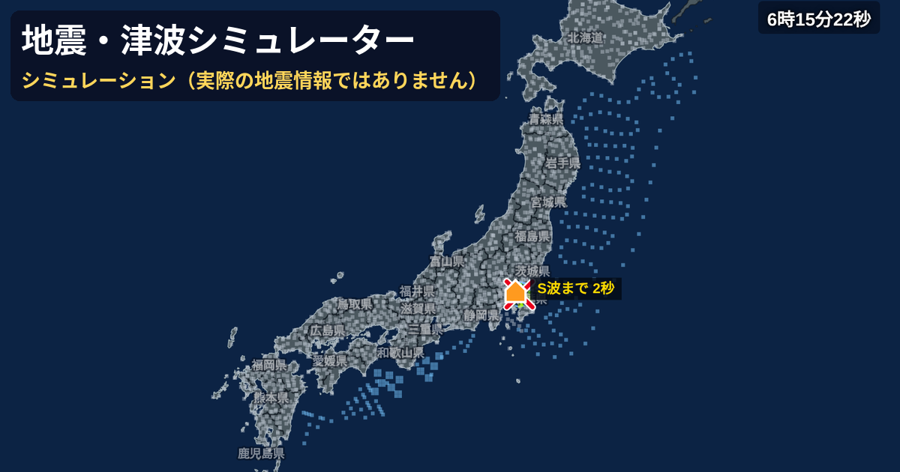

# 地震・津波シミュレーター

地盤の揺れやすさを加味して日本全国の震度を推定し、**緊急地震速報・震度速報・津波警報・津波観測に関する情報**をテレビ放送風に再現するブラウザ用シミュレーターです。インストール不要で、PCでもスマホでも動きます。

  <a href="https://ryiot443311.github.io/earthquake_and_tsunami-simulator/"><b>▶ ブラウザで開く</b></a>

> [!IMPORTANT]
> これはシミュレーションです。**実際の地震・津波情報ではありません。** 計算はすべて簡略化した近似で、実際の防災の判断には使えません。気象庁・NHK・防災科学技術研究所とは関係ありません。

## 目次

- [できること](#できること)
- [使い方](#使い方)
- [おすすめの地震・シナリオ](#おすすめの地震シナリオ)
- [動作環境](#動作環境)
- [計算の仕組み](#計算の仕組み)
- [ライセンス・クレジット](#ライセンスクレジット)
- [不具合・要望](#不具合要望)

## できること

### 🔴 緊急地震速報
- 予報・警報、第1報から最終報までの続報を再現（震源・M・深さが報ごとに精度を増す）
- PLUM法、P波検知の遅れ、震源の誤差、**2つの地震の誤認**、誤報と取消報
- 巨大地震は緊急地震速報の段階でMを小さめに推定し、その後の情報でモーメントマグニチュードへ段階的に更新（2011年の M7.9→8.4→8.8→9.0 の形）
- NHK風の横テロップ・縦テロップ。対象地域は予測震度の大きい順で、既に出た地域の順番は変えない。広い範囲は地方名で表示
- 遠くの地震（日本から800km以上）は「遠地地震に関する情報」として発表

### 🟦 震度・地震情報
- J-SHIS 表層地盤の増幅率を使った市区町村ごとの震度推定（揺れのばらつきも再現）
- 震度速報、震源・震度に関する情報、長周期地震動階級
- P波・S波の広がりを地図に表示

### 🌊 津波
- 断層モデル（Okada の式）で津波の高さと到達時刻を計算
- 津波警報・注意報は**気象庁の津波予報データベース方式**を再現（推定した震源の周りの候補の最大を採用、巨大地震は第1報を「巨大」「高い」で発表し約15分後に数値へ更新）
- 周辺・対岸の予報区の扱い（大津波警報と注意報が隣り合わない、狭い海を挟んで向かい合う予報区はそろえる）
- 津波観測に関する情報（沿岸・沖合の全観測点）と、観測による警報の引き上げ
- 「震度｜津波」の切り替えで、予報区ごとの高さと第1波の時刻を地図に表示

### 🏠 室内の揺れ（3D）
- 地図で選んだ地点のリビングの揺れを3Dで表示（建物の種類・階数を選択）
- 家具の移動・転倒、本や食器の落下、割れ物、テレビ・照明の揺れを物理演算で再現。程度は気象庁の震度階級関連解説表に合わせて調整
- 転倒防止対策（突っ張り棒・ベルト・耐震ジェル・滑り止めシート・扉のラッチ）のあり／なし
- 対象地域ならテレビに緊急地震速報、机のスマホに緊急速報メール風の通知

### ⚙️ そのほか
- 震源・規模（M2.0〜M10.0）・深さ・断層の型と向き・破壊の進み方を指定
- 複数の地震（最大8つ、連続・同時発生）
- 速度の変更（×1〜×64）、30秒戻る・進む、次の地震の直前まで進む
- 設定をURLで共有
- 警報音（初期設定はオフ・控えめな音量）

## 使い方

1. **[ブラウザで開く](https://ryiot443311.github.io/earthquake_and_tsunami-simulator/)**（または `index.html` をダウンロードしてブラウザで開く）
2. 「震源」タブで地図をタップして震源を置き、規模や深さを設定（「過去の地震・想定から選ぶ」から選んでも OK）
3. **「地震発生」** を押す
4. 「速報・震度」タブで発表の履歴、「室内の揺れ」タブで3Dの部屋を見る
5. 速度ボタンで早送り（長押しで一覧）。津波の地震は最長4時間まで続けて見られます

| 操作 | 方法 |
| --- | --- |
| 地図の移動・拡大 | ドラッグ、ピンチ／マウスホイール |
| 揺れを見る地点を変える | 「揺れを見る地点」を選んで地図をタップ |
| 震度と津波の表示を切り替え | 地図左上の「震度｜津波」 |
| 設定を共有 | 画面上部の共有ボタンでURLをコピー |
| 細かい設定 | 「詳細設定」タブ（観測網、揺れのばらつき、誤認の起こりやすさ、表示の形式など） |

## おすすめの地震・シナリオ

「過去の地震・想定から選ぶ」からすぐに試せます。

| プリセット | 内容 |
| --- | --- |
| 東北沖 M9.0 | 巨大地震の緊急地震速報・Mの更新・大津波警報 |
| 南海トラフ M9.1 | 太平洋沿岸から瀬戸内海までの津波 |
| 能登半島 M7.6 | 日本海側の津波 |
| 首都直下 M7.3 | 都市部の強い揺れ（津波なし） |
| 小笠原 深発 M8.1 | 深い地震による遠方の揺れ |
| ほか | 熊本 M7.3、十勝沖 M8.0、福島県沖 M7.4、千葉県東方沖 M5.2 |

| シナリオ | 内容 |
| --- | --- |
| 熊本地震 本震から64分 | 本震＋余震7回（地震ごとの震度速報） |
| 東日本大震災 本震から60分 | M9.0＋主な余震4回 |
| 南海トラフ 東側→西側（半割れ） | 時間差で起きる2つの巨大地震 |
| ほぼ同時（茨城県南部＋千葉県北西部） | 近い場所で6秒差で起きる2つの地震 |
| 能登 本震＋余震2回 | 続けて起きる地震 |

## 動作環境

- PC・スマホの最新の Chrome / Edge / Safari / Firefox
- `index.html` の1ファイルだけで動きます。地盤データ・three.js・警報音などはすべてファイル内に入っており、外部への通信は Google Fonts だけです（無くても代替フォントで表示されます）
- 室内の3D表示は端末の性能によって重くなることがあります（スマホは自動で画質を調整します）

## 計算の仕組み

使っている式・モデル・近似は **[docs/simulation.md](docs/simulation.md)** にまとめています。

- 震度：司・翠川（1999）の距離減衰式＋J-SHIS 表層地盤の増幅率
- 緊急地震速報：震源・Mの推定とPLUM法による予測震度
- 津波：Okada（1985）の断層モデル＋グリーンの法則、気象庁の津波予報データベース方式を簡略化
- 室内の揺れ：合成した地震波形＋建物の揺れ（1質点系）＋剛体の物理演算

## ライセンス・クレジット

- コードは [MIT License](LICENSE) です
- 同梱しているデータ・ライブラリは、それぞれの条件に従います（[CREDITS.md](CREDITS.md)）

## 不具合・要望

不具合の修正や機能の追加を続けています。気づいた点や要望があれば、ぜひ [Issues](https://github.com/ryiot443311/earthquake_and_tsunami-simulator/issues) で教えてください。
